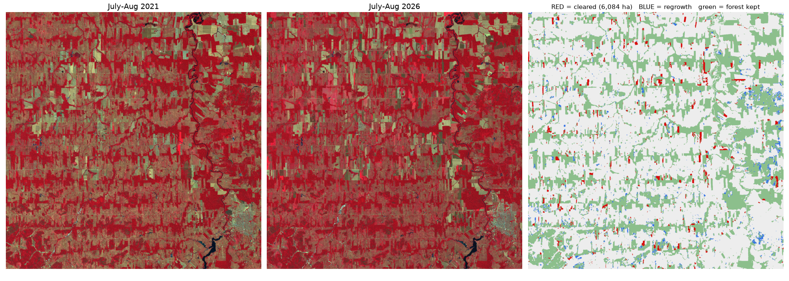

# Watching the Amazon Disappear from Space 🌳🛰️

I trained a deep learning model to find forest in satellite photos, then used it to spot where forest in the Brazilian Amazon was cut down between 2021 and 2026. Then I checked it by hand, found out what it was getting wrong, and fixed it.


*An 8 x 8 km piece of Rondônia, Brazil. On the left is July 2021, in the middle is July 2026, and on the right my model marks the forest that disappeared in red.*

## Why I made this

I kept reading news like "the Amazon lost X football fields of forest this year" and I always wondered: how does anyone actually know that? Who is counting the trees?

It turns out the answer is satellites. The European Space Agency has a satellite called Sentinel-2 that photographs the whole planet every few days, and the pictures are free for anyone. So I wanted to see if I could do the counting myself, with my own code, starting from raw satellite pictures and ending with a map that shows exactly where the forest went.

I picked Rondônia because it is one of the most deforested places on Earth. From above it looks like a fishbone: roads cut into the forest, and farms spread out from both sides.

## What I found

| | |
|---|---|
| Area I studied | about 55 x 55 km in Rondônia, Brazil |
| Natural forest cut down from 2021 to 2026 | **about 6,800 hectares** (95% range 6,200 to 7,500) |
| How big is that? | roughly **9,500 football fields** |
| Cleared patches on my map | 926 (most are a few hectares, the biggest is 115 hectares) |
| Of the patches my map flags, how many really were cleared | **88%**, checked by hand on 300 random points |
| Overall accuracy of the map | **92%** |

The hectares come from my hand check, not just from the map, because a map's own count is off by however many mistakes it makes. The map itself says 6,084 hectares, a bit under the real number, because it misses some clearings.

## How it works, in 5 steps

**1. Get the satellite pictures.**
I download Sentinel-2 pictures for July and August of 2021 and of 2026. I use the same months both times on purpose: in June the pasture is still green from the rain and looks a bit like forest, but by July it dries out, so forest and farmland are easy to tell apart. Clouds are a big problem in the Amazon, so I take 8 pictures for each year and, for every pixel, keep the middle value of the cloud free ones. That gives one clean, cloud free picture per year.

**2. Teach a model what forest looks like.**
I cut my 2021 picture into 441 small squares and trained a U-Net, a kind of neural network made for coloring in each pixel of an image. For the answers it learns from, I use MapBiomas, Brazil's own yearly land cover map (more on why below). I trained it for free on a Kaggle GPU. To keep the test honest, the squares I tested on come from different parts of the map than the ones it learned from, so it can't just memorize its neighbors.

**3. Make both years look the same.**
The 2026 pictures came out a little brighter than 2021, not because the ground changed but because of haze and changes in how the satellite data is processed. So I found pixels that should never change, like old forest and town roofs, and used them to adjust the 2026 colors to match 2021.

**4. Map the forest in both years and compare.**
I ran the model over the whole area for each year, so every pixel gets a forest score from 0 to 100%. A pixel counts as cleared only if the model was confident it was forest in 2021 (60% or more) and confident it isn't forest in 2026 (40% or less). I also throw away tiny specks smaller than half a hectare, because those are usually just noise at the edges of the forest.

**5. Put it on a map.**
Every cleared patch becomes a red shape on an interactive map. You can click a patch to see how big it is, and switch between the 2021 and 2026 pictures to watch the forest vanish.



*The whole 55 x 55 km area. Red is forest that was cleared, green is forest that stayed. (Ignore the blue: it's what the model thought was regrowth, and my hand checks showed that part is not reliable.)*

## How I got here: three versions and two hand checks

My first model was not this good. Getting from there to here was the most interesting part of the project.

### Version 1: learning from WorldCover

My first model learned from ESA WorldCover, a free world map of tree cover. It matched WorldCover really well (91% IoU on test squares, compared to 85% for a simple "greenness" rule), and it found 8,705 hectares of clearing.

To check it, I first compared it with Global Forest Change, a well known yearly map of forest loss from the University of Maryland. **94%** of what I marked as cleared, they also saw as cleared at some point. Where we disagreed, most spots turned out to be forest that **burned in 2024 but is still standing**. Their map counts any lost tree cover, while I was looking for forest turned into farmland, which is a different question.


### Hand check 1: looking at 300 points myself

Comparing with another map only tells you how much two maps agree, and every map has its own mistakes. So I did what scientists do to measure a map properly: I picked 300 random points and looked at each one myself, in the 2021 and 2026 pictures, and wrote down what really happened there.

A few things I did to keep it honest:

* **I labelled blind.** My labelling page never showed what the model had said about a point, so I couldn't be nudged into agreeing with it.
* **I picked points from every part of the map.** Cleared land is only about 3% of the area, so 300 purely random points would have given me only about 9 cleared ones. Instead I picked a fixed number of points from each part of the map (cleared, forest, non forest...) and then weighted each point by how much area it stands for. This is called stratified random sampling, and it's the standard method (Olofsson et al. 2014).

It showed that only **64%** of what version 1 called cleared really was. The biggest problem: **the model thought green crops, plantations and young bushy regrowth were forest**, so when those got cut, it reported cleared forest. It also showed the regrowth map didn't work at all, so I stopped claiming a regrowth number.

### Version 2: a better camera (didn't work)

My first guess was that the model couldn't *see* the difference. Sentinel-2 also measures shortwave infrared (SWIR), which shows how much water is in leaves and soil, so forest canopy looks very different from dry crops and scrub. I added the two SWIR bands and two SWIR indices (NDMI for leaf moisture, NBR for burn scars) and retrained the exact same model on the exact same squares.

| | Version 1 | Version 2 (with SWIR) |
|---|---|---|
| Overall accuracy (hand check 1) | 86.6% | 86.1% |
| Of what it called cleared, how much really was | 64% | 58% |
| Of all real clearing, how much it found | 57% | 54% |

No real improvement, all inside the uncertainty ranges. That told me something important: **the model learns whatever its answer key says is forest.** WorldCover itself counts some plantations and bushy regrowth as tree cover, so the model faithfully copied that habit, no matter how good its inputs were. The problem was the labels, not the camera.

### Version 3: a better answer key (worked!)

So I changed only the answer key. MapBiomas is Brazil's own yearly land cover map, made by a network of Brazilian universities and NGOs, and it separates natural forest from plantations, pasture, crops and mixed farmland. It has a map for every year since 1985, so I also used the history: if a pixel was forest in 2021 but had been farmland at any point in the 10 years before, it's young regrowth, and I told the model to skip it rather than guess. I wrote this rule down before training, so I couldn't bend it to get nicer numbers.

Everything else stayed the same: same bands, same model, same squares, same settings.

### Hand check 2: a fresh 300 points

My first 300 points had already been used to judge versions 1 and 2. Picking a winner on them again would mean slowly tuning to my own test, so I labelled **300 new points**. This time I put extra points where versions 1 and 3 disagreed, since that's where the comparison is decided, and along forest edges, where missed clearings like to hide.

| On 300 fresh points | Version 1 (WorldCover) | Version 3 (MapBiomas) |
|---|---|---|
| Overall accuracy | 87% (82 to 91) | **92%** (88 to 96) |
| Of what it called cleared, how much really was | 59% (52 to 65) | **88%** (82 to 93) |
| Of all real clearing, how much it found | 75% (71 to 78) | **78%** (72 to 85) |

The places where they disagreed tell the story:

* Where **only version 1** said cleared, **42 of 60** points were never forest at all. Those were the crops and scrub, and version 3 learned to ignore them.
* Where **only version 3** said cleared, **43 of 60** really were cleared, so it also found clearings version 1 missed.
* Where **both** said cleared, **49 of 50** really were.
* **Not one** of the 60 forest edge points was a hidden clearing.

Version 3 still has a weak spot: most of its false alarms were forest that is **burnt or thinned but still standing**. MapBiomas is strict about what counts as forest, so the model sometimes calls damaged forest "not forest". Adding a separate class for degraded forest would be the next thing to fix.

You can see every point and my labels in [`validation/`](validation/) (round 1) and [`validation2/`](validation2/) (round 2).

## Try the map yourself

Download [`outputs/deforestation_map.html`](outputs/deforestation_map.html) and open it in any browser. No setup needed.

## Run it yourself

```bash
pip install -r requirements.txt

python src/01_search.py               # find satellite pictures
python src/02_composite.py before     # build the clean 2021 picture
python src/02_composite.py after      # build the clean 2026 picture
python src/03b_labels_mapbiomas.py    # forest answers from MapBiomas (plus 03_labels.py for WorldCover)
python src/04_tiles.py mapbiomas      # cut into training squares
# train: notebooks/kaggle_v3/ (pushed to Kaggle with `kaggle kernels push`), weights in models/v3/
python src/07_normalize.py            # match 2026 brightness to 2021
python src/08_predict.py v3           # forest map for both years
python src/09_change.py v3            # find what was cleared
python src/11_map.py                  # build the interactive map
python src/13b_sample_round2.py       # pick 300 points + labelling page
# label them in validation2/labeler.html, save labels.csv into validation2/
python src/14_accuracy.py v3 round2   # accuracy and real area from your labels
```

Versions 1 and 2 can be rebuilt the same way (`04_tiles.py`, `04_tiles.py swir`, `08_predict.py`, `08_predict.py v2` and so on). All three trained models are in `models/`, so you can skip training.

## What I want to try next

* Teach the model about **degraded forest** (burnt or thinned but standing), its main remaining mistake.
* Try it on **other parts of the Amazon** to see if it still works somewhere it has never seen.

## Built with

Python, PyTorch, Sentinel-2 imagery from Microsoft Planetary Computer, MapBiomas Brazil (Collection 9), ESA WorldCover, Hansen Global Forest Change, GeoPandas, Rasterio and Folium.
