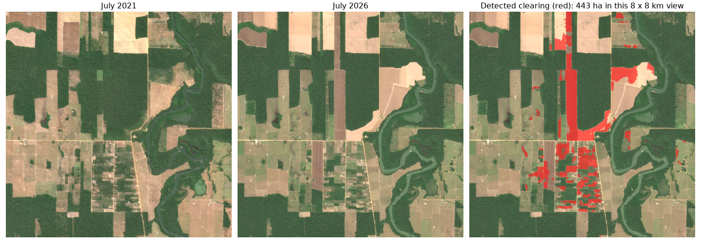
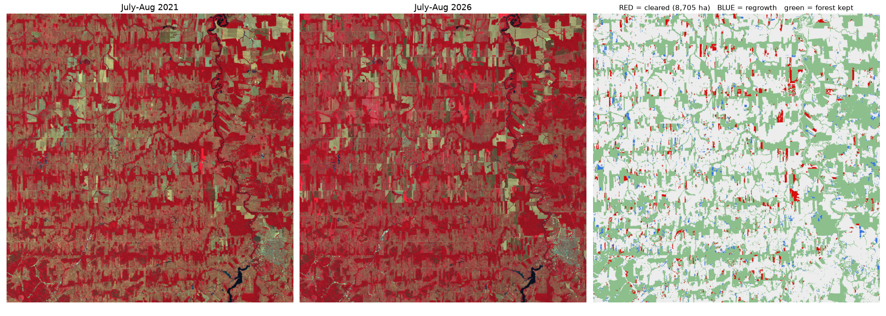
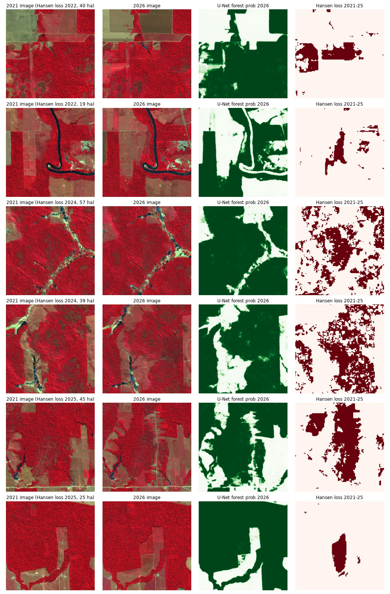

# Watching the Amazon Disappear from Space 🌳🛰️

I trained a deep learning model to find forest in satellite photos, then used it to spot where forest in the Brazilian Amazon was cut down between 2021 and 2026.



*An 8 x 8 km piece of Rondônia, Brazil. On the left is July 2021, in the middle is July 2026, and on the right my model marks the forest that disappeared in red.*

## Why I made this

I kept reading news like "the Amazon lost X football fields of forest this year" and I always wondered: how does anyone actually know that? Who is counting the trees?

It turns out the answer is satellites. The European Space Agency has a satellite called Sentinel-2 that photographs the whole planet every few days, and the pictures are free for anyone. So I wanted to see if I could do the counting myself, with my own code, starting from raw satellite pictures and ending with a map that shows exactly where the forest went.

I picked Rondônia because it is one of the most deforested places on Earth. From above it looks like a fishbone: roads cut into the forest, and farms spread out from both sides.

## What I found

| | |
|---|---|
| Area I studied | about 55 x 55 km in Rondônia, Brazil |
| Forest cut down from 2021 to 2026 | **8,705 hectares**, about 7% of the forest that was there in 2021 |
| How big is that? | roughly **12,000 football fields** |
| Number of separate cleared patches | 1,762 (most are small, the biggest is 239 hectares) |
| How well my model finds forest | **91% IoU** on areas it never saw while learning |
| A simple "greenness" rule for comparison | 85% IoU |

IoU is a score for how well two maps overlap. 100% would mean my forest map matches the real one perfectly.

## How it works, in 5 steps

**1. Get the satellite pictures.**
I download Sentinel-2 pictures for July and August of 2021 and of 2026. I use the same months both times on purpose: in June the pasture is still green from the rain and looks a bit like forest, but by July it dries out, so forest and farmland are easy to tell apart. Clouds are a big problem in the Amazon, so I take 8 pictures for each year and, for every pixel, keep the middle value of the cloud free ones. That gives one clean, cloud free picture per year.

**2. Teach a model what forest looks like.**
For the answers, I use a free world map from the European Space Agency (WorldCover 2021) that already says which pixels are trees. I cut my 2021 picture into 441 small squares and trained a U-Net, a kind of neural network made for coloring in each pixel of an image. I trained it for free on a Kaggle GPU. To keep the test honest, the squares I tested on come from different parts of the map than the ones it learned from, so it can't just memorize its neighbors.

**3. Make both years look the same.**
The 2026 pictures came out a little brighter than 2021, not because the ground changed but because of haze and changes in how the satellite data is processed. So I found pixels that should never change, like old forest and town roofs, and used them to adjust the 2026 colors to match 2021.

**4. Map the forest in both years and compare.**
I ran the model over the whole area for each year, so every pixel gets a forest score from 0 to 100%. A pixel counts as cleared only if the model was confident it was forest in 2021 (60% or more) and confident it isn't forest in 2026 (40% or less). I also throw away tiny specks smaller than half a hectare, because those are usually just noise at the edges of the forest.

**5. Put it on a map.**
Every cleared patch becomes a red shape on an interactive map. You can click a patch to see how big it is, and switch between the 2021 and 2026 pictures to watch the forest vanish.



*The whole 55 x 55 km area. Red is forest that was cleared, blue is forest growing back, green is forest that stayed.*

## Did I get it right?

To check myself, I compared my results with Global Forest Change, a well known yearly map of forest loss made by scientists at the University of Maryland.

The good news: **94%** of what I marked as cleared, they also saw as cleared at some point. My model also agreed with them more than the simple greenness rule did.

The interesting part was where we disagreed. I looked at those spots one by one, and most of them turned out to be forest that **burned in 2024 but is still standing**. Their map counts any lost tree cover, while I was looking for forest turned into farmland, which is a different question. A few were real misses though, like a thin new logging road and a clearing that had only just started.



## Try the map yourself

Download [`outputs/deforestation_map.html`](outputs/deforestation_map.html) and open it in any browser. No setup needed.

## Run it yourself

```bash
pip install -r requirements.txt

python src/01_search.py              # find satellite pictures
python src/02_composite.py before    # build the clean 2021 picture
python src/02_composite.py after     # build the clean 2026 picture
python src/03_labels.py              # get the forest answers (WorldCover)
python src/04_tiles.py               # cut into training squares
python src/05_ndvi_baseline.py       # the simple greenness rule, to beat
# train the model: notebooks/forest-unet-rondonia.ipynb (I used a Kaggle GPU)
python src/07_normalize.py           # match 2026 brightness to 2021
python src/08_predict.py             # forest map for both years
python src/09_change.py              # find what was cleared
python src/10_validate_hansen.py     # compare with Global Forest Change
python src/11_map.py                 # build the interactive map
```

The trained model is already in `models/best_unet.pt`, so you can skip the training step.

## What I want to try next

Sentinel-2 also takes pictures in infrared light that shows burn scars clearly. Adding those would help the model tell burned forest apart from cleared forest. I would also like to try it on other parts of the Amazon to see if it still works there.

## Built with

Python, PyTorch, Sentinel-2 imagery from Microsoft Planetary Computer, ESA WorldCover, Hansen Global Forest Change, GeoPandas, Rasterio and Folium.
